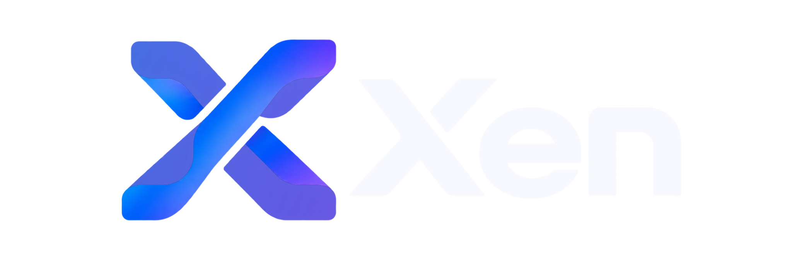

<p align="center">
  <picture>
    <source srcset="assets/branding/black.png" media="(prefers-color-scheme: dark)">
    
  </picture>
</p>

<p align="center">
  <strong>A small language for command-line programs.</strong><br>
  <a href="docs/en/README.md">English guide</a> ·
  <a href="docs/ko/README.md">한국어 사용자 문서</a> ·
  <a href="examples/README.md">Examples</a> ·
  <a href="CONTRIBUTING.md">Contributing</a>
</p>

<div align="center">

  [](https://github.com/skystarry-team/Xen/actions/workflows/release.yml)
  
</div>


Xen lets you write small programs using functions, strings, vectors, structs,
and explicit error handling. Build a standalone executable or run a source file
directly with the `xen` command.

**Xen is an early release.** Syntax and APIs may change. Programs run on Linux
x86-64 and AArch64, Windows x86-64, and Apple Silicon macOS. AArch64, Windows and macOS support are experimental;
validation on physical hardware is pending. Windows compiler, PE execution and
standard library tests pass on Windows Server 2022 native CI; Windows desktop
validation on physical hardware is still required. Native Apple Silicon CI validation is pending;
Windows ARM64 and Intel macOS are unsupported.

## Write your first program

Save this as `hello.xen`:

```xen
fn main() {
    println("Hello, Xen!");
}
```

With Xen installed on your PATH:

```console
$ xen run hello.xen
Hello, Xen!
```

Check the code or make an executable:

```sh
xen check hello.xen
xen build hello.xen -o hello
./hello
```

Follow [your first program](docs/en/getting-started.md) or
[첫 프로그램 실행하기](docs/ko/getting-started.md) for setup and explanations.
Debian/Ubuntu users can install the matching `xen-lang` `.deb` from
[GitHub Releases](https://github.com/skystarry-team/Xen/releases) with
`sudo apt install ./xen-lang_<version>_amd64.deb` (or `_arm64.deb`).
See [packaging and OS compatibility](docs/compiler-build/en/packaging.md).
Windows x86-64 users can use the portable ZIP; see
[Windows installation](docs/compiler-build/en/installation.md#windows-x86-64-experimental).
Installation and source builds are covered in the separate
[compiler build guide](docs/compiler-build/README.md).
From an extracted distribution use `./bin/xen`; from this repository use
`compiler/dist/xen` if `xen` is not on PATH.

## Learn by using the language

The [English guide](docs/en/README.md) and [한국어 문서](docs/ko/README.md) follow
the same path: values, functions, collections, types, ownership, errors, modules,
and tests. Build a [word-counting tool](docs/en/tutorial.md), then consult the
[standard library](docs/en/stdlib.md) while writing your own program.

The [example collection](examples/README.md) contains complete learning programs,
their commands, and expected output. Compiler development notes live under
[`compiler/`](compiler/README.md), and contributor verification under
[`tests/`](tests/README.md).

Bug reports and small reproducible improvements are welcome at
[skystarry-team/Xen](https://github.com/skystarry-team/Xen).
See [contributing](CONTRIBUTING.md) to work on the project.

## License and artwork

Copyright © 2026 vmintf(minsung). The license depends on the path:

| Material | License |
| --- | --- |
| Compiler source and executable | Apache-2.0 |
| Generative/metamorphic verification (`tests/property/`, `tests/semantic_ir_test.ml`) | Apache-2.0 |
| Other original code and documentation | MIT OR Apache-2.0 |
| Branding PNGs | CC BY 4.0 |

[LICENSE](LICENSE) defines the scope and the dual-license exception for Xen
runtime code included in generated user executables. Third-party components
retain their own licenses; see [THIRD_PARTY.md](THIRD_PARTY.md).

The Xen logo and icons are **AI-generated artwork**, supplied by vmintf(minsung).
Their [provenance, attribution and CC BY 4.0 terms](assets/branding/README.md)
are separate from the code licenses.

Compiler internals and target boundaries: [compiler architecture](compiler/README.md).
